+++
date = '2026-11-17T21:00:00+08:00'
draft = false
title = '把文生图模型拆开看：Qwen-Image-2.1 与 FLUX.3 Klein 的 3D 可视化'
description = '在 A100 上真实跑一次 1024×1024 出图，把每一步、每一层的激活与注意力导出成数据，再用纯 JavaScript + WebGL2 做成和 llm-viz 一样可以逐层、逐步、逐词查看的 3D 讲解。附两个模型的实测架构与全部数字。'
categories = ['深度学习']
tags = ['文生图', 'Diffusion', 'Transfusion', 'Qwen-Image', 'FLUX', 'Transformer', 'WebGL', '可视化']
+++

> **在线体验 👉 [/image-viz/](/image-viz/)**　｜　姊妹篇：[LLM 可视化](/llm-viz/)

上一篇文章里我用 REA + Craft Anything 逆向并复刻了 [bbycroft.net/llm](https://bbycroft.net/llm)——那个页面之所以好看，是因为它里面**每一个方块都是一个真实的数**：一次 GPT 推理的权重和激活，被一格一格画出来。

这次我想把同一件事用在**文生图模型**上：把 Qwen-Image-2.1（16.2B）和 FLUX.3 Image Klein（10.1B）在 A100 上真实跑一次 1024×1024 出图，抓下每一步、每一层的中间结果，做成一个可以逐层、逐步、逐词查看的 3D 页面。

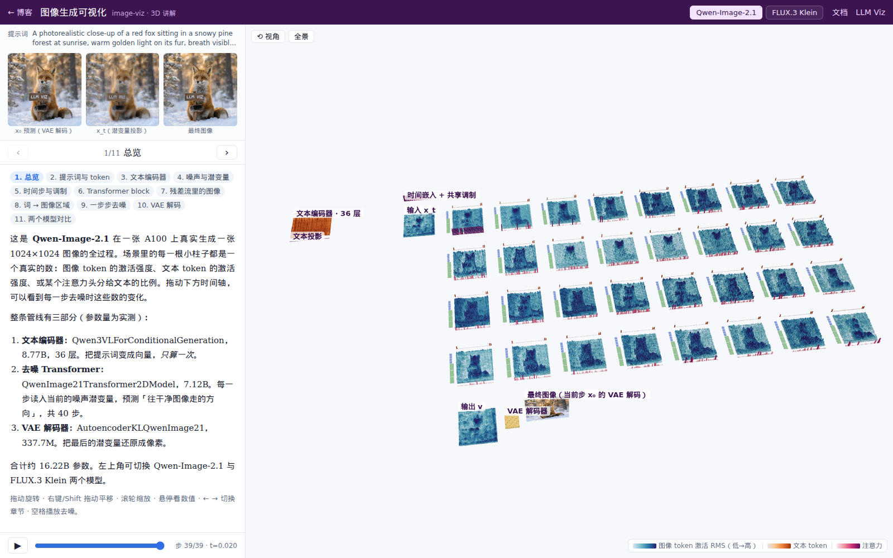

最终成品：

- **两个模型、11 章中文讲解**：总览 → 提示词与 token → 文本编码器 → 噪声与潜变量 → 时间步与调制 → Transformer block → 残差流里的图像 → 词到图像区域 → 一步步去噪 → VAE 解码 → 两个模型对比。
- **每一步都是真的**：Qwen 走 40 步、FLUX 走 16 步，每步抓取所有 32（或 33）个 block 的 64×64 图像 token 激活。拖动时间轴，格子会跟着变。
- **注意力是复算出来的**：导出时用模型自己的 QK-Norm 与 RoPE 重算 softmax，把「每个图像位置对每个词的注意力」画成热图。`LLM`、`VIZ` 集中在狐狸举的木牌上，`fox` 勾出狐狸，`paws` 落在爪子上，`trees`、`background` 落在背景。
- **x₀ 是真解码的**：每步的速度 v 按 `x0 ≈ x_t − t·v` 得到估计，**真的送进 VAE 解码**，和 pipeline 自己的输出逐像素比对，平均误差只有 0.30/255。
- **零依赖、零构建**：一个 `index.html` + 5 个 ES 模块 + 一份 13 MB 的数据目录。

---

## 目录

1. [为什么文生图比 LLM 难画](#1-为什么文生图比-llm-难画)
2. [环境与加载方式](#2-环境与加载方式)
3. [Qwen-Image-2.1：单流 + 块因果](#3-qwen-image-21单流--块因果)
4. [FLUX.3 Klein：先分流、后合流](#4-flux3-klein先分流后合流)
5. [两个模型放在一张表里](#5-两个模型放在一张表里)
6. [要导出哪些数据](#6-要导出哪些数据)
7. [怎么导出：探针、钩子与注意力复算](#7-怎么导出探针钩子与注意力复算)
8. [校验：我们抓到的数是真的吗](#8-校验我们抓到的数是真的吗)
9. [可视化设计：怎么把 4096 个 token 画成一片风景](#9-可视化设计怎么把-4096-个-token-画成一片风景)
10. [渲染实现：WebGL2 实例化](#10-渲染实现webgl2-实例化)
11. [看到了什么](#11-看到了什么)
12. [局限与它为什么不撒谎](#12-局限与它为什么不撒谎)
13. [本地运行、重新导出与部署](#13-本地运行重新导出与部署)
14. [踩坑记录](#14-踩坑记录)
15. [版权与致谢](#15-版权与致谢)

---

## 1. 为什么文生图比 LLM 难画

llm-viz 能做得那么干净，是因为 GPT 的一次推理是**一次前向**：输入 6 个字母，跑一遍，输出 6 个分布。所有张量都在同一时刻存在，把它们按计算顺序摆开就行。

文生图模型不是这样：

**第一，它不是一次前向，是几十次。** 你要画的是 40 次（Qwen）或 16 次（FLUX）形状完全相同的 Transformer 前向，每次的输入都是上一步的输出。所以时间必须成为一个可拖动的轴，而不能只是"第 N 层的左边"。

**第二，token 不是词，是图像块。** LLM 的 6 个 token 一眼能数完；这里一条序列里有 **4096 个图像 token**（64×64 的潜变量网格），加上 79 或 80 个文本 token。4096 个格子必须排成二维，才能看出"哪里是狐狸、哪里是雪"。

**第三，没有"下一个词"这种可读的输出。** LLM 的输出是词表上的概率，读得懂；这里每一步的输出是一个 64 维（Qwen）或 128 维（FLUX）的速度场，它在潜空间里，人眼看不见。必须先解码，或者投影。

**第四，层数多、参数多。** 16.2B 参数不可能一格一格画。只能"一个张量 = 一个按参数量缩放的盒子"，再把 4096 个 token 的激活铺在盒子上当颜色。

想清楚这四点之后，问题就变成了一个很具体的工程问题：**导出什么数据，能让浏览器在没有模型权重的情况下，把一个 16B 模型的内部状态画出来？** 这个问题的答案就是整个页面的设计。

---

## 2. 环境与加载方式

全部推理在 `a100so03`（A100-SXM4-40GB）上完成，环境 `/pretrain/zhuxinxin/work/envs/env312`：

```
torch 2.11.0+cu128 · diffusers 0.42.1 · transformers 5.20.1
```

加载方式与 `/pretrain/zhuxinxin/work/model_server/adapters.py` 里的 `Qwenimage21`、`FLUX3KleinAdapter` **完全一致**——这不是为了省事，而是因为照着服务端的真实加载路径走，才能保证看到的架构就是线上跑的那个架构（而不是某个 demo 脚本里简化过的版本）。FLUX 按 `infer.sh direct` 的做法跳过 PUP（perceptual upsampler），因为文生图不需要它。

```bash
PY=/pretrain/zhuxinxin/work/envs/env312/bin/python
cd /pretrain/zhuxinxin/work/imgviz_arch

CUDA_VISIBLE_DEVICES=5 $PY arch_probe.py  --model qwen --out runs/qwen
CUDA_VISIBLE_DEVICES=4 $PY arch_probe.py  --model flux --out runs/flux
CUDA_VISIBLE_DEVICES=5 $PY export_web.py --model qwen --out web/qwen --probe runs/qwen/summary.json
CUDA_VISIBLE_DEVICES=4 $PY export_web.py --model flux --out web/flux --probe runs/flux/summary.json
```

两个模型用同一个提示词、同一个 seed（42）、同一个分辨率（1024²）：

> *A photorealistic close-up of a red fox sitting in a snowy pine forest at sunrise, warm golden light on its fur, breath visible in the cold air, holding a small wooden sign in its paws that reads "LLM VIZ" in white painted letters, shallow depth of field, soft bokeh of snow-covered trees in the background*

选这个提示词不是随手写的。它同时包含：**一个主体**（狐狸）、**一个可定位的小物体**（木牌）、**一段具体文字**（LLM VIZ）、**三类材质**（毛发 / 雪 / 木）、**一种光照**（日出金光）和**一种景深**（背景虚化）。这些正好是"注意力到底学没学到东西"最好的试金石。

---

## 3. Qwen-Image-2.1：单流 + 块因果

Qwen-Image-2.1 是 **Transfusion 式**的结构：文本和图像 token 在同一个序列里，用同一套权重。

```
提示词 ──Qwen3-VL(36 层)──► 取最后一层（去掉最终 RMSNorm）→ 丢弃 system 段
                        → encoder_hidden_states [1, 79, 4096]
                        → txt_in: ZeroCenterRMSNorm → Linear → GELU → Linear

噪声潜变量 [1,64,64,64] ─flatten─► [1, 4096, 64] ─img_in─► [1, 4096, 4096]

拼接：79 个文本 token + 4096 个图像 token = [1, 4175, 4096]

t ─正弦 256 维─► TimestepEmbedding → temb [2, 4096]（第 2 行是 t=0，给文本用）
                ─modulation: SiLU → Linear(4096→16384)─► 4 份 scale/gate
× 32 个 QwenImage21TransformerBlock
    x += tanh(gate1) · Attn( LN(x)·(1+scale1) )
    x += tanh(gate2) · SwiGLU( LN(x)·(1+scale2) )
norm_out（只有 scale 的 AdaLN）→ proj_out → 取最后 4096 个 = 速度 v
```

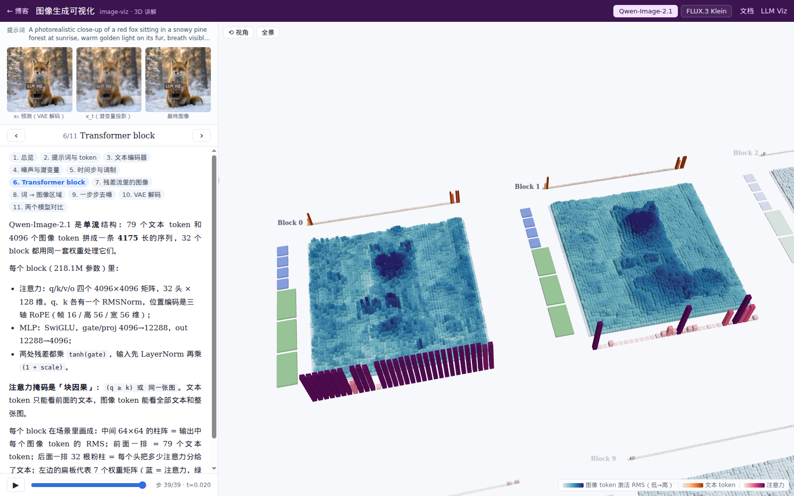

几个读了源码才敢写的设计：

**只有一条流。** 每层 7 个大矩阵——q、k、v、o 四个 4096²，加上 SwiGLU 的 gate/proj（4096→12288）和 out（12288→4096）。**每层 218.1M 参数，32 层占整个 7.12B 的 98.1%。**

**调制参数全模型共享。** 有一个 `modulation` 线性层（4096→16384，约 67M 参数）**所有 32 个 block 共用**，block 自己一个调制参数都没有。这一点和 DiT 系列里每个 block 自带 AdaLN 的做法不同，省下的是 32 × 67M ≈ 2.1B 参数。

**块因果注意力。** 掩码是 `(q ≥ k) 或 同一图像`：文本 token 严格因果（只能看前面），图像 token 能看全部 79 个文本 token 和整张图。关键在于——**文本 token 用 `t=0` 的调制**（`causal_condition=True`），所以它们的 K/V 全程不变。于是第一步预填前缀 KV，后面每步只算 4096 个图像 token：

| | 首步 | 之后每步 |
|---|---|---|
| 实测单次前向 | 0.49 s | 0.376 s |

**三轴 RoPE（16, 56, 56）。** 文本 token 三个轴同时递增，图像 token 的帧轴冻在前文的位置，高/宽轴以 0 为中心铺成网格。

**VAE 是 16× 下采样、64 通道，输出 RGBA。** 这是个小坑：`AutoencoderKLQwenImage21` 解码出来是 4 通道（带 alpha），存 JPEG 前必须按 pipeline 的做法合成到白底上，否则 `PIL` 会直接报错。

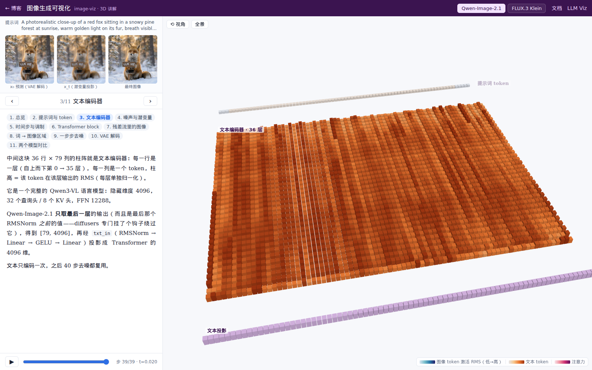

文本编码器是 **Qwen3-VL 8.77B**（36 层，hidden 4096，32 头 / 8 KV 头，FFN 12288）。它包含 0.58B 的视觉塔和 0.62B 的 lm_head，文生图时**都不参与**——我们只取最后一层、最后一个 token 之前、丢掉最终 RMSNorm 的隐状态。另外聊天模板会注入一段 14 个 token 的 system prompt，导出时被丢掉了，所以最终是 **79 个文本 token**。

---

## 4. FLUX.3 Klein：先分流、后合流

FLUX.3 Klein 是 **MMDiT 式**的两段式：前 5 层各模态独立，后 28 层联合。

```
提示词 ──Qwen3-VL-4B──► 取第 4,8,…,32 共 8 层隐状态，按通道堆叠：8 × 2560 = 20480
                      → [1, 80, 20480] → context_embedder → [1, 80, 3072]

噪声潜变量 32ch，2×2 打包 → [1, 4096, 128] ─x_embedders.image─► [1, 4096, 3072]

t 与 target_t（本步要跳到哪）各自嵌入后相加 → 逐 token 调制

① 分流 5 层（Flux3ModeTransformerBlock，各模态只在自己内部做自注意力）
   txt_mode_blocks      ×5 : 文本  [1, 80,   3072]
   mode_blocks.image    ×5 : 图像  [1, 4096, 3072]
   mode_blocks.image_cond ×5: 参考图（编辑模式才用，本次未执行）
   每层：并行结构  x += gate · ( Attn(m) + FF(m) ),  m = LN(x)·(1+scale)+shift

② 合流 28 层（Flux3SingleTransformerBlock）
   [文本 80 ; 图像 4096] = 4176 个 token 做联合注意力，文本/图像各用自己的调制

③ norm_out（AdaLN）→ proj_out → 速度 v
```

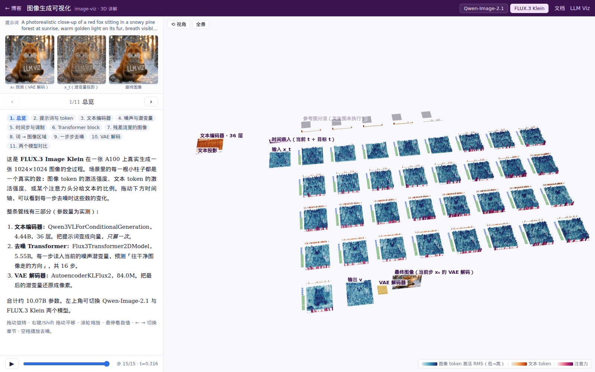

**并行块。** 注意力与 FFN 用同一个调制后的输入并行计算再相加，而不是串行两个残差。FFN 是 SwiGLU，`linear_in` 一次输出 2×9216 再对半分。

**每层 122.7M 参数**：4 个 3072² + 3072×18432 + 9216×3072。合流 28 层占 61.9%，三组分流各占 11.1%。

**四轴 RoPE（t, h, w, l，各 32 维）**，图像部分的 RoPE 缩放了 0.5。

**调制按模态分 6 组**（早期/合流 × image / image_cond / txt），每组一个 3072→9216 的线性层，**逐 token 生效**（不是整批一个标量）。

**流映射蒸馏。** 模型多一个 `target_timestep_embedder`，它同时知道"现在在 t"和"要跳到哪"。实测 16 步的时间表：

```
1.000 → 0.992 → 0.980 → 0.969 → 0.953 → 0.938 → 0.922 → 0.898
      → 0.875 → 0.844 → 0.805 → 0.758 → 0.699 → 0.617 → 0.498 → 0.316 → 0
```

最后一步从 0.316 **直接跳到 0**。对比 Qwen 的 40 步平滑下降表（1.0 → 0.988 → … → 0.068 → 0.020），能看出来这不是"少跑了几步"，而是完全不同的采样范式。

**文本编码用 8 层中间隐状态堆叠**（20480 维），而不是像 Qwen 那样只用最后一层（4096 维）。5 倍宽的输入，这也是后面 FLUX 文本流 RMS 高得多的原因之一。

**VAE 只有 84M**，32 通道潜变量，8× 下采样后再 2×2 打包成 128 通道——所以 `x_embedders.image` 吃的是 128 维。

---

## 5. 两个模型放在一张表里

全部数字来自 `named_parameters()` 与真实推理，不是论文或模型卡上抄的。

| | Qwen-Image-2.1 | FLUX.3 Image Klein |
|---|---|---|
| 文本编码器 | `Qwen3VLForConditionalGeneration` **8.77B**（36 层，hidden 4096，FFN 12288，32 头 / 8 KV 头） | `Qwen3VLForConditionalGeneration` **4.44B**（Qwen3-VL-4B：36 层，hidden 2560，FFN 9728） |
| 去噪 Transformer | `QwenImage21Transformer2DModel` **7.12B**，297 个张量 | `Flux3Transformer2DModel` **5.55B**，359 个张量 |
| VAE | `AutoencoderKLQwenImage21` **0.338B**（z=64，16×） | `AutoencoderKLFlux2` **0.084B**（32ch，8× + 2×2 打包） |
| 合计 | **≈16.2B** | **≈10.1B** |
| 结构 | 32 层单流，块因果 | 5 层分流 + 28 层合流 |
| 注意力 | 块因果，文本严格因果 | 分流内自注意力 / 合流联合全注意力 |
| RoPE | 3 轴（16, 56, 56） | 4 轴（32, 32, 32, 32） |
| 调制 | 全模型共享 1 个（4096→16384） | 按模态 6 组（3072→9216），逐 token |
| 文本特征 | 最后一层，4096 维 | 8 层堆叠，20480 维 |
| 序列长度 | 79 + 4096 = 4175 | 80 + 4096 = 4176 |
| 去噪步数 | 40 | 16（流映射蒸馏） |
| 生成耗时 | **16.2 s** | **5.5 s** |
| 单次 Transformer | 0.38 s（首步 0.49 s） | 0.28 s |
| 文本编码 / VAE 解码 | 0.21 s / 0.41 s | 0.39 s / 0.37 s |
| 显存峰值 | **36.8 GB** | **21.2 GB** |
| 加载耗时 | 31 s | 21 s |

同一个提示词、同一块 A100-40GB：FLUX 快了 **2.9 倍**，显存少了 **42%**，参数量少了 **38%**。差别不只是"步数少"，它每一层的参数也少（122.7M vs 218.1M），文本编码器也小一半。

---

## 6. 要导出哪些数据

这是整个项目真正的设计环节。约束有三条：

1. **浏览器里不能有模型权重。** 16B 参数是 32 GB，不可能下载。
2. **不能导 4096 个格子 × 4175 个 token × 32 层。** 那是几百 GB。
3. **但每一格都必须是真的数。** 一旦开始"示意"，这个页面就失去了存在意义。

于是把"真"落实到三处可验证的地方，其余降采样：

| 数据 | 真实性 | 体积 |
|---|---|---|
| `final.jpg` | 最终潜变量经 **VAE 真实解码** | 768² |
| `steps/x0_XX.jpg` | 每步 `x0 = x_t − t·v`，**真实 VAE 解码** | 256² × 步数 |
| `steps/xt_XX.jpg` | 潜变量的**线性 RGB 投影**（示意，见第 12 节） | 256² × 步数 |
| `act/act_XX.png` | 该步每个 block 输出的 **64×64 图像 token RMS**，8 位灰度图集 | 每格 64² |
| `attn/sSS_bBB.png` | 选定步/层上**复算的 softmax**，词 → 区域 | 20 词 × 64² |
| `meta.json` | 形状、参数量、时间表、逐步逐层统计、性能实测 | 几百 KB |

导出后 Qwen 8.2 MB、FLUX 4.5 MB。全部是可公开的统计量与生成结果，**不含任何权重**。

`act_XX.png` 是个 8 列 × N 行的图集（R8 灰度），tile 顺序是 `["x_t", …所有 block…, "v"]`——Qwen 34 个、FLUX 35 个。用一张 PNG 装下所有层，既省请求也让 GPU 端可以一次上传成纹理。

---

## 7. 怎么导出：探针、钩子与注意力复算

导出分两步。

### arch_probe.py：先摸清结构

```bash
python arch_probe.py --model qwen --out runs/qwen
```

它做四件事：

1. **按服务端的方式加载模型**，然后 `named_parameters()` 走一遍，把每个张量的名字和形状记下来（`transformer_tensors.json`）。Qwen 297 个、FLUX 359 个。
2. **给每个 module 挂前向钩子**，记录它第一次被调用时的输入/输出形状（`first_call_shapes`）。这就是页面上那些箭头和形状标注的来源。
3. **跑一次完整推理**，记录每步耗时、VAE 解码耗时、显存峰值。
4. **存下每步的潜变量**（`latents.pt`），供后面复用。

钩子这里踩过一个坑：一开始我用 lambda 返回一个元组想"改写"输出，结果 PyTorch 把元组当成**替换参数**传给了 forward。改成返回 `None` 的函数就好了。

### export_web.py：再抓网页要的东西

```bash
python export_web.py --model qwen --out web/qwen --probe runs/qwen/summary.json
```

它跟 `arch_probe` 用同样的加载方式，但挂了更多钩子：

**激活。** 每个 block 的 forward 输出取出图像 token 那 4096 行，reshape 成 64×64，算每个 token 的 RMS，量化成 8 位存进图集。**每张图单独归一化**——因为不同层的 RMS 差了好几个数量级（见第 5 节和第 11 节），统一归一化的话中间层会变成全黑。

**注意力。** 这一步是整个项目最费劲的地方。

diffusers 的注意力实现不会把 attn 矩阵交出来，而且开了 `scaled_dot_product_attention` 之后根本拿不到。所以不能"顺便记一下"，只能**按模型自己的公式重算**：

```
1. 取该 block 的 q 或 k 的投影前输入（通过钩子拿到 hidden_states）
2. 用该 block 自己的 RMSNorm 归一化 q、k
3. 用该 block 自己的 RoPE 位置编码旋一遍
4. q @ kᵀ / sqrt(d) → softmax（只在"文本 key"上取，因为我们要的是"图像 query 分给文本多少")
5. 32 个头取平均 → 64×64
```

只有这样才能得到**和模型内部一模一样**的注意力。代价是必须一步步重跑，而且 Qwen 得关掉前缀 KV 缓存（`use_kv_cache=False`）——数值完全不变，只是每步多算 79 个文本 token，所以导出耗时 28.6 s 比探针的 16.2 s 长。

为了控制体积，只抓 **5 个步 × 5 个 block**：

| | 步 | 层 |
|---|---|---|
| Qwen | 0, 5, 10, 20, 39 | 0, 8, 16, 24, 31 |
| FLUX | 0, 2, 5, 10, 15 | 0, 7, 14, 21, 27 |

每一步、每一层都把**全部 20 个词**的热图横向拼成一张 1280×64 的条带。拖时间轴和切层的时候，页面会自动吸附到最近的一个抓取点。

另外还导出了两个"总账"指标：

- **`txt_frac`**：这一层所有图像 query 的注意力里，分给文本 token 的总比例（等价于"这一层还在看提示词吗"）。
- **`head_frac`**：32（或 24）个注意力头里，各自分给文本的比例——画成 block 后面那排柱子。

---

## 8. 校验：我们抓到的数是真的吗

这是整个流程里我最在意的部分。可视化最容易犯的错是"看起来挺像，其实是编的"。所以做了三层校验。

**第一层：x₀ 与 pipeline 输出逐像素比对。**

每步的 `x0 = x_t − t·v` 真的送进 VAE 解码，然后与 pipeline 自己产出的最终图比较（0–255 尺度）：

| | 平均绝对误差 |
|---|---|
| Qwen-Image-2.1 | **0.299** |
| FLUX.3 Klein | **0.265** |

即 <0.12%。说明抓到的 `x_t` 和 `v` 与模型真实的计算路径完全对得上——只要有一个钩子挂错了位置，这个数会立刻变成几十。

**第二层：注意力有没有语义。**

如果复算的注意力公式错了（比如 RoPE 应用错了轴，或者忘了 QK-Norm），热图会退化成一片均匀的雾。实际上：

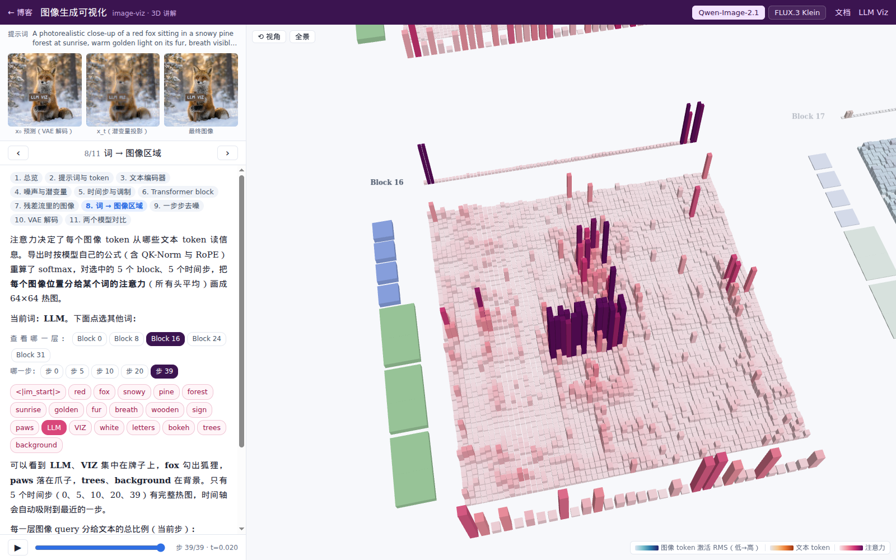

`LLM`、`VIZ` 两个词的热图在画面中央偏上、正好是木牌的位置出现两团高亮；`fox` 勾出狐狸的轮廓；`paws` 落在狐狸胸前两只爪子上；`trees`、`background` 落在四周虚化的背景。同时，同一张热图里右下角和边缘也有零散的高柱——那是背景 bokeh，也说得通。

FLUX 那边同样成立：

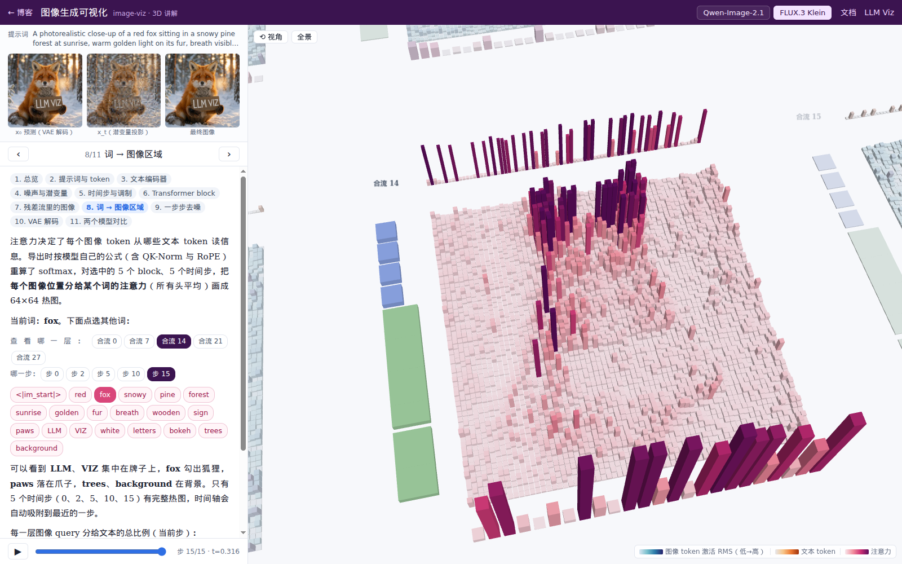

**第三层：步与层之间的连续性。**

`txt_frac` 随层数的变化必须是连续的。实测 Qwen 的第 0 层文本注意力占比高达 0.82（第一层几乎是"把提示词抄进图像 token"），第 1 层骤降到 0.15，然后在中层升到 0.42 左右，深层又降回 0.2–0.3。这个形状与"浅层写入语义、中层整合、深层收敛到速度场"的直觉一致。如果导出脚本有 bug，这条曲线会是锯齿状的。

---

## 9. 可视化设计：怎么把 4096 个 token 画成一片风景

有了数据，剩下的问题是排版。llm-viz 的经验是：**一个张量一个盒子，把序列方向摊成平面。**

### 场景布局

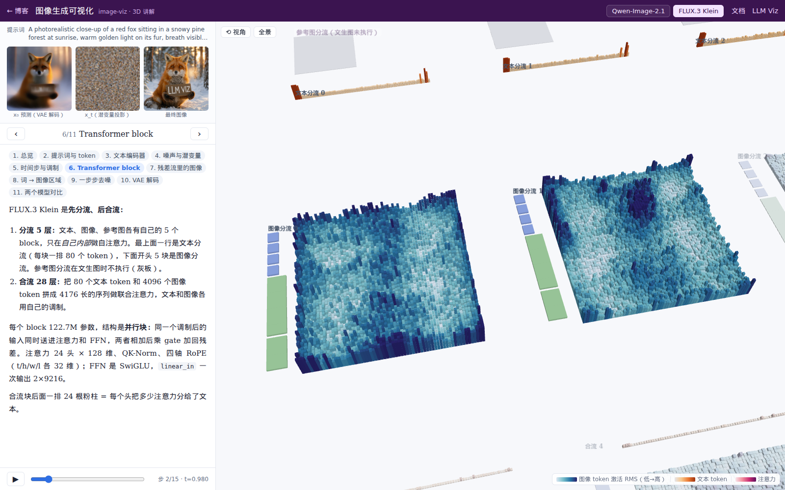

从左上到右下：

1. **文本编码器**（最左）：36 层竖着摞，每层一条 79/80 个 token 的细柱。
2. **文本投影**（`txt_in` / `context_embedder`）：一个宽扁的盒子，按参数量缩放。
3. **输入 x_t**：一张 64×64 的格子板。
4. **时间步嵌入 + 调制**：在 Qwen 里只有**一个**共享调制层，所以它孤零零地站在场景的左边；FLUX 有 6 组，所以这里画的是"当前 t + 目标 t"两个嵌入之和。
5. **Transformer blocks**：一行 8 个，每个 block 一块 64×64 的格子板。
6. **输出 v**、**VAE 解码器**、**最终图像平面**。

FLUX 多一排：最上面灰色的 **参考图分流**（`image_cond` 5 层）。文生图模式不执行它，所以画成灰色平板并标注"文生图未执行"——这个"空着的分支"本身就是一种信息。

每个 block 的格子板周围还有三样东西：

- **前面一排（79/80 根柱子）**：文本 token 在这一层的激活。
- **后面一排（32/24 根柱子）**：每个注意力头分给文本的比例（`head_frac`）。
- **左边一列扁板**：这一层的 7 个权重矩阵，**按参数量缩放**。Qwen 是 4 个 attention + 3 个 MLP，比例 1:1:1:1:3:3:3；FLUX 是 4 个 attention + 2 个 FFN，比例 1:1:1:1:6:3。7 个方块之间真的能看出 SwiGLU 的 `12288/4096 = 3` 倍宽。

### 颜色与高度

三个调色板，各管一件事：

- **蓝**：图像 token 的激活 RMS（浅蓝 → 深蓝）。
- **橙**：文本 token 的激活。
- **洋红**：注意力。

格子高度是 `h = h0 + hmax · f(val)`，其中 `f` 是幂函数（激活用 `val^1.4`，注意力用 `val^0.8`）。指数是必需的：注意力分布极度长尾，线性映射会让 99% 的格子贴地、1% 的格子顶到天花板；`val^0.8` 把长尾压下来，才看得见"两团高亮"而不是"两根针"。

在注意力模式里，高度还会乘 1.8——因为注意力模式的格子只有 4096 个，比总览里稀疏得多，需要更夸张才读得出来。

### 相机

`frame(box, {yaw, pitch, pad})` 不是简单地取包围球半径，而是**把包围盒沿相机的两个屏幕轴投影**：

```
across = sx·|cos yaw| + sz·|sin yaw|
along  = (sx·|sin yaw| + sz·|cos yaw|)·sin pitch + sy·cos pitch
dist   = pad · max(across/2/th, along/2/tv) + max(sx, sz)·0.08
```

这样当相机俯视一张 64×64 的平板时，距离会正确收敛，而不是被包围球的半径推得远远的（这是第一版最大的问题：所有章节都像在看一粒米）。

---

## 10. 渲染实现：WebGL2 实例化

整个渲染器 232 行，没有依赖。

**每个格子一个立方体实例**：Qwen 14.6 万个、FLUX 15.0 万个（39 / 46 个组）。实例数据 12 个 float：

```
x, y, z, s   |   src, u, v, palette   |   groupId, hmax, h0, staticColor
```

**顶点着色器从三张纹理取值**：

| 纹理 | 格式 | 内容 |
|---|---|---|
| 图集 | `R8` | 某个 block 在某一步的 64×64 激活（8 位列宽） |
| 标量 | `R32F` | 逐帧变化的单值，如时间轴上的 t |
| 状态 | `RGBA32F`，每组一张 64×64 | r=亮度（变暗系数）、g=揭示进度、b=调色板覆盖（或 −1）、a=高度缩放 |

状态纹理是 llm-viz 那套"逐组变暗 / 逐格揭示"动画的复用：讲某一章时，非重点组把 `r` 调到 0.45 并**压平高度**（`hmax` 乘 0.25），被讲的组保持满高。这不是特异功能，只是每帧上传一张 64×64 的浮点纹理。

立方体 6 个面、36 个顶点，逆时针绕序 `[0,2,1,0,3,2]`，开 `CULL_FACE`。第一版我把绕序写反了，结果所有方块看起来都是空心的——你看到的是内壁。

悬停拾取不用射线求交库，而是**沿射线步进**：以格子高度为单位往前走，每一步把世界坐标换成格子索引，再看该处高度是否超过射线当前高度。对 15 万个立方体来说，这比逐实例求交快得多。

---

## 11. 看到了什么

把所有数据摆在一起之后，有几件事挺有意思。

**构图在第 0 步就定了。** 这是最反直觉的。第 0 步（纯噪声）的 `x₀` 估计里，狐狸已经居中、背景已经是雪林和中景虚化——

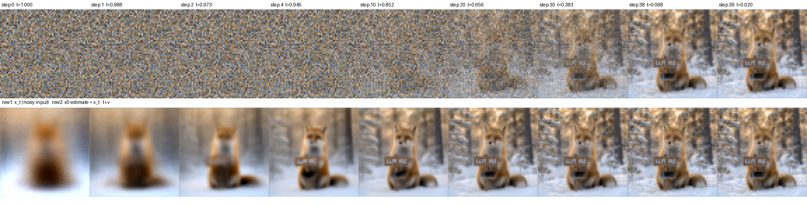

之后 39 步主要在补毛发、雪粒、木牌上的笔画。这说明模型把大部分"决策"放在了第一步：位置、构图、语义关系全在一次前向里定好，后续只是细化。

**FLUX 的文字出现得更早。** 蒸馏版在**第 2 步**（t=0.98）就能看出 "LLM VIZ" 的字样，Qwen 要到第 4 步左右。16 步不是"40 步的抽样"——流映射蒸馏学的是一种"一步到位"的步进策略，所以早期步做出的判断更激进。

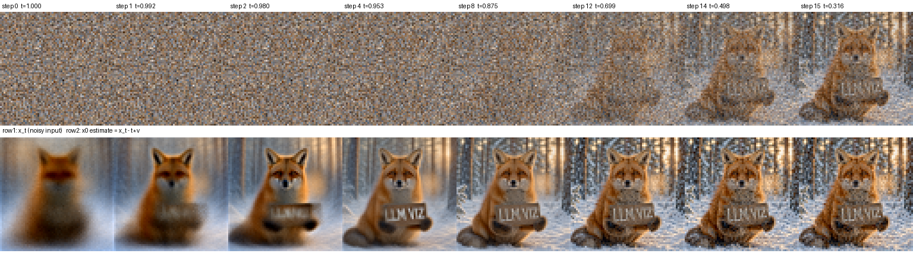

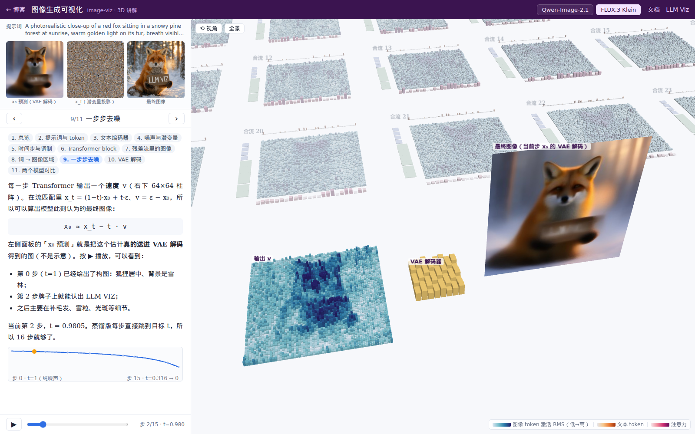

**x_t 在 t>0.6 时基本还是噪声。** 看上行：前面十几步的 `x_t` 几乎是纯噪点。信息不是"存在当前状态里逐步变清晰"，而是"模型每一步都预测一个干净的目标，然后沿这个方向走一小段"。这也解释了为什么只要 `x₀` 预测稳定，步数少也能出好图。

**FLUX 的文本流激活是图像流的几十倍。**

| 流 | 整体 RMS |
|---|---|
| FLUX 文本分流 0→4 | 575 → 2013（与 t 无关） |
| FLUX 图像分流 0→4 | 4–30 |
| FLUX 合流 0→27 | 23–56 |
| Qwen block 0→31 | 4–25 |

文本 token 用 `t=0` 调制，与去噪步无关，所以整列是同一个数；而输入是 8 层隐状态的堆叠（20480 维），量级天然就大。**所以页面上文本柱子和图像格子用了不同的调色板和各自的归一化**——否则要么文本柱子全顶到头，要么图像一片平。

**Qwen 的中层有一段"被抹平"的区域。**

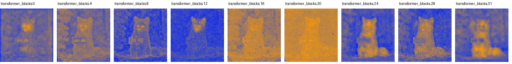

block 16–20 的热图几乎是均匀的，整体 RMS 也掉到 4–5；到 block 24 之后轮廓又重新出现。浅层（0–12）能清楚看到牌子和狐狸的轮廓，深层又模糊成一团——因为最后一层输出的已经不是"图"，而是"速度场"。

FLUX 合流的中间层（3–23）则一直很"结构化"，狐狸的眼睛、鼻子和牌子始终最亮。

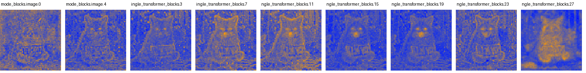

两条路径的差别其实能对上架构：Qwen 是 32 层同构单流，信息被反复读写同一个残差流；FLUX 是先在自己模态里打磨 5 层、再合流 28 层，联合注意力天然更"局部"。

**注意力是一个很好的"模型在找什么"的探针。** 同一个词在不同层、不同步的热图完全不一样：早期层里，`LLM` 可能只在一片区域泛泛地亮；到合流 14 层，它会精确地收到木牌上的那两行笔画。这也侧面说明了为什么这两代模型要多层、多步——单层的注意力不足以定位到这么小的区域。

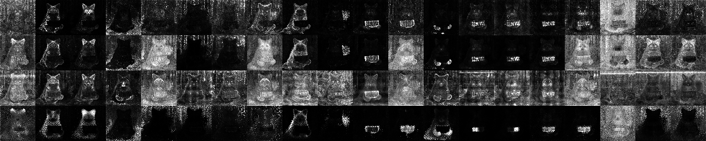

---

## 12. 局限与它为什么不撒谎

诚实地说清楚哪些地方不是严格线性的、哪些是抽样的：

1. **`xt_XX.jpg` 只是示意。** 潜变量有 64（Qwen）或 128（FLUX）个通道，没法直接显示。这里用最小二乘拟合了一个线性 RGB 映射（以最终图像缩到 64×64 为目标），平均误差 Qwen 0.024 / FLUX 0.053（0–1 尺度）。能看构图，颜色不准。**要看"模型认为的图"，请看 `x0_XX.jpg`，那是真的 VAE 解码。**
2. **激活图每格单独归一化。** 颜色只表示同一层内 4096 个图像 token 之间的相对强弱，不能跨层比较绝对大小。要看绝对量级，用章节里的逐步 RMS 曲线。
3. **文本 token 的激活只抓了第一步和最后一步。** 文本 token 用 `t=0` 调制，与步数无关，中间步是插值显示的。
4. **注意力只抓了 5 步 × 5 层。** 全量是 40 步 × 32 层 × 32 头 × 4175 个 token。
5. **方块高度做了截断与压缩。** `hmax` 和幂函数让 4096 个格子在一个屏幕上可读；没有任何一个维度是严格线性的。
6. **耗时是单卡裸跑，不含加载。** 也没有用 `torch.compile`、没开 `bf16` 之外的低精度、没做 batch。这是"这个模型在这块卡上跑一次"的数字，不是"这个模型的性能上限"。

第 3–6 条都是"少画一点"，而不是"画错一点"——每一格存在的数都是真的。这是我觉得这类可视化唯一站得住的立场。

---

## 13. 本地运行、重新导出与部署

### 本地看

```bash
cd static && python3 -m http.server 8000
# http://localhost:8000/image-viz/            默认 Qwen-Image-2.1
# http://localhost:8000/image-viz/?model=flux  FLUX.3 Klein
```

必须通过 HTTP 访问（`file://` 下 ES 模块和 `fetch` 会被浏览器拦截），浏览器需支持 WebGL2。

### 重新导出

见第 2 节。三个脚本都在 [`tools/image-viz/`](https://github.com/sunCityDaa/sunCityDaa.github.io/tree/master/tools/image-viz)：

| 脚本 | 作用 |
|---|---|
| `arch_probe.py` | 结构探针：张量名字/形状、首次调用形状、耗时、显存、逐步潜变量 |
| `export_web.py` | 网页数据：x0/x_t、激活图集、词→区域注意力、VAE 解码校验 |
| `montage.py` | 报告用的拼图与热图 |

换提示词只需要 `--prompt`，换 seed 只需要 `--seed`。词表是从分词结果里自动挑的（去掉标点和纯空格 token），所以换提示词不需要改代码。

### 改讲解

只改 `static/image-viz/js/walkthrough.js`：`html` 改文字，`focus` 改高亮哪些组，`cam` 改相机，`step` 改停在哪一步。

### 调试接口

页面加载后，控制台里：

```js
__imgviz.gotoChapter(7)      // 跳到第 8 章「词 → 图像区域」
__imgviz.setStep(20)         // 切到第 20 步（吸附到最近的抓取步）
__imgviz.app.meta.blocks     // 当前模型每一层的参数与形状
__imgviz.CHAPTERS.map(c => c.title)
```

### 部署

本站的 `public/` 是提交进仓库的构建产物，GitHub Pages 从 `gh-pages` 分支发布。改完内容后：

```bash
hugo --cleanDestinationDir      # 需要 extended 版本 + Tailwind v4 CLI
```

`static/image-viz/` 会被原样复制到 `public/image-viz/`，这篇文章生成到 `public/posts/image-viz/`。

---

## 14. 踩坑记录

1. **Qwen 的 VAE 输出 4 通道。** `AutoencoderKLQwenImage21` 解码出来带 alpha，直接存 JPEG 会炸。按 pipeline 的做法合成到白底上才对，否则整张图会偏色。
2. **注意力拿不到。** diffusers 开了 SDPA 之后不返回 attn 矩阵，`output_attentions=True` 也只对一部分实现有效。最后只能按公式复算——而这反而是最可靠的，因为它顺便证明了我们对 QK-Norm 和 RoPE 的理解是对的。
3. **复算注意力要用对 RoPE 的轴。** 四个轴里如果错一个，热图会立刻变成均匀噪声。第一次就错了：把帧轴和高度轴弄反了，`fox` 的热图变成了棋盘格。
4. **关掉 KV 缓存会让导出变慢。** 但数值一点不变（`use_kv_cache=False` 只是每步多算文本 token），所以这是个纯耗时问题，不是正确性问题。
5. **钩子不能返回元组。** 返回 `None` 是"只观察"，返回元组会被当成"替换前向参数"。
6. **每层单独归一化是必须的。** 第一次全模型统一归一化，block 16–20 全黑、最后一层全白，什么也看不见。
7. **相机被包围球害了。** 第一版所有章节都像在看一粒米。改成按屏幕轴投影包围盒之后才对。
8. **立方体绕序写反 = 空心方块。** 你看的是内壁。修好之后才想起还缺一个底面。
9. **`git commit-tree` 报 "empty ident"。** 在 orphan 提交里手写树的时候，忘了设 `GIT_AUTHOR_NAME` / `GIT_COMMITTER_EMAIL`。
10. **写文件必须指定 UTF-8。** 导出脚本在 a100 的默认 locale 下写中文注释会撞上 latin-1 编码错误。

---

## 15. 版权与致谢

- **Qwen-Image-2.1** 由通义实验室（Hangzhou Tongyi Laboratory Technology Co., Ltd.）发布，许可证为 **Qwen Research License Agreement**（仅限非商业研究/评估用途）。按协议第 3(c) 条，此处声明：

  > Qwen is licensed under the Qwen RESEARCH LICENSE AGREEMENT, Copyright (c) 2026 Hangzhou Tongyi Laboratory Technology Co., Ltd. All Rights Reserved.

- **FLUX.3 Image Klein** 由 Black Forest Labs Inc. 发布，许可证为 **FLUX Kommunity License v1.0**。按协议第 3(b) 条，此处声明：

  > This FLUX Model is licensed by Black Forest Labs Inc. under the FLUX Kommunity License. Copyright Black Forest Labs Inc. IN NO EVENT SHALL BLACK FOREST LABS INC. BE LIABLE FOR ANY CLAIM, DAMAGES OR OTHER LIABILITY, WHETHER IN AN ACTION OF CONTRACT, TORT OR OTHERWISE, ARISING FROM, OUT OF OR IN CONNECTION WITH USE OF THIS MODEL.

- **本页不包含、也不分发任何模型权重。** 展示的是模型输出（图像）与统计量；按两份许可证，输出不构成模型的衍生作品。
- **AI 生成内容声明**：本页与本文中的所有图像均由上述模型生成，是合成图像而非真实照片。
- 本站为非商业的个人博客，符合两个许可证的非商业使用条款。
- 视觉风格借自 [Brendan Bycroft 的 LLM Visualization](https://bbycroft.net/llm)（MIT）——这是我为它做的姊妹篇；本页代码为重新编写。
- 推理环境、模型权重与 `adapters.py` 由 `zhuxinxin` 提供；实测在 `a100so03` 上完成。

完整许可证文本见 [`static/image-viz/LICENSE-THIRD-PARTY.md`](https://github.com/sunCityDaa/sunCityDaa.github.io/blob/master/static/image-viz/LICENSE-THIRD-PARTY.md)。
