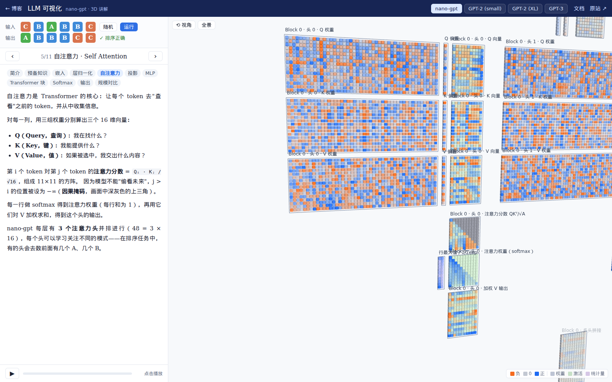
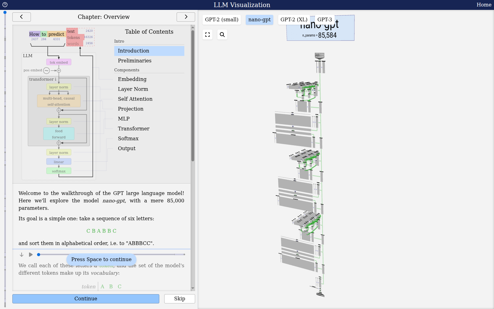
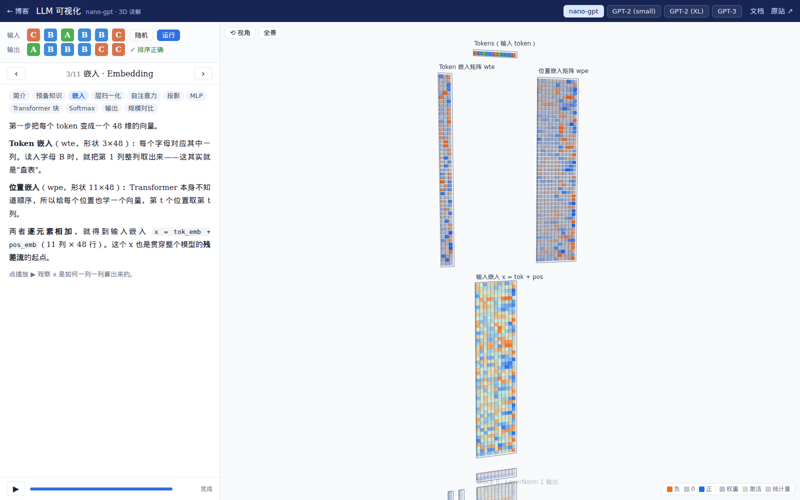
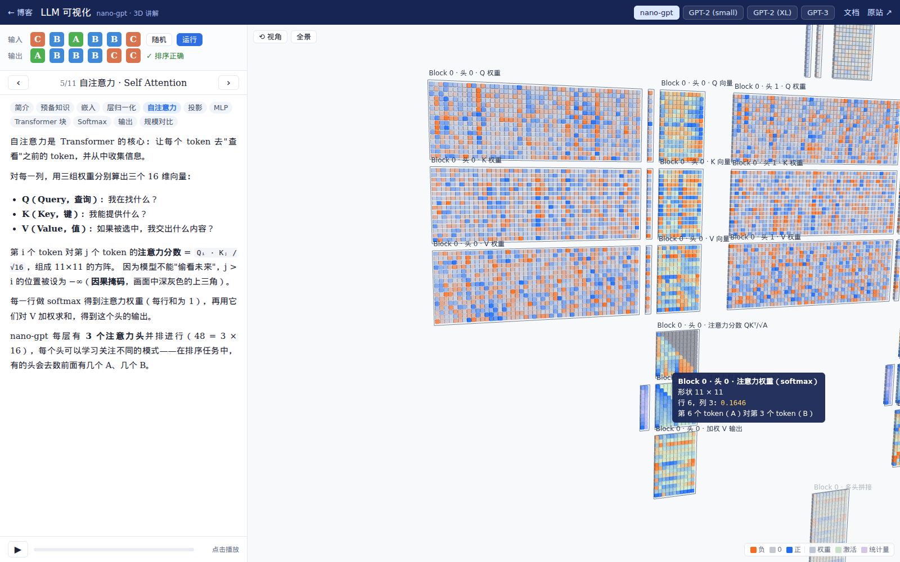
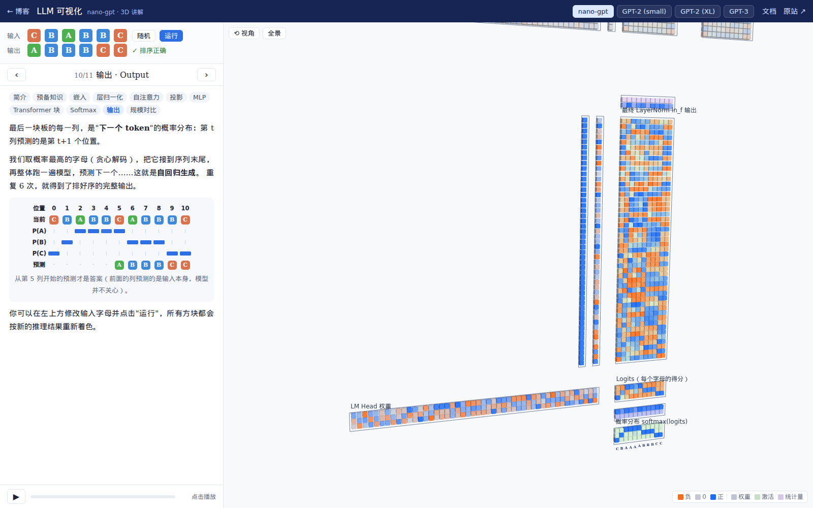
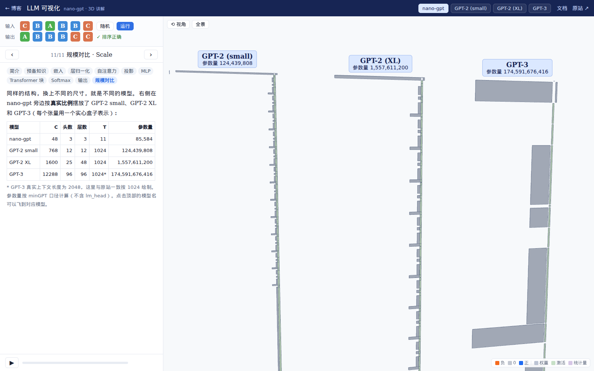
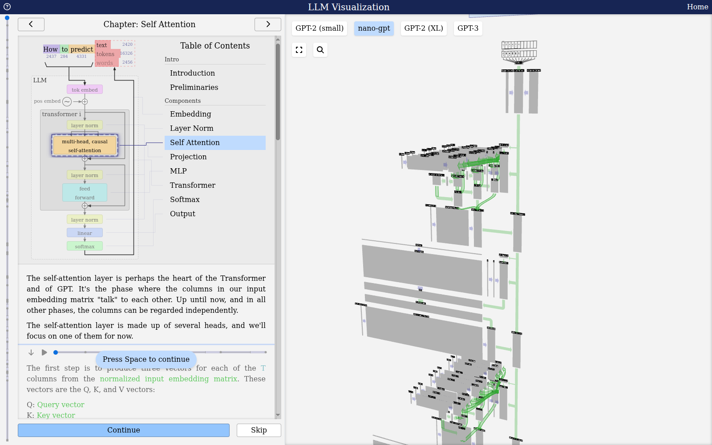
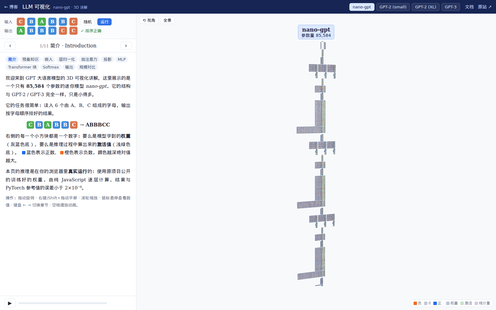

+++
date = '2026-11-16T10:00:00+08:00'
draft = false
title = '用 REA + Craft Anything 逆向并复刻 LLM 3D 可视化（bbycroft.net/llm）'
description = '完整记录：如何用 morluto/rea 与 storytold/craft-anything 两个逆向工具分析 bbycroft.net/llm，并用纯 JavaScript + WebGL2 从零复刻一个在浏览器里真实跑推理的 GPT 3D 可视化。'
categories = ['逆向工程']
tags = ['LLM', 'GPT', 'Transformer', 'WebGL', '逆向工程', 'REA', 'Craft Anything', '可视化']
+++

> **在线体验 👉 [/llm-viz/](/llm-viz/)**　｜　原站：<https://bbycroft.net/llm>

Brendan Bycroft 的 [LLM Visualization](https://bbycroft.net/llm) 是我见过讲 GPT 内部结构最直观的作品：它把一个真实的小型 GPT 的每一个权重、每一个中间结果都画成 3D 空间里的小方块，配合逐章讲解，一步一步展示一次推理是怎么完成的。

这篇文章完整记录了我做的一件事：**用两个开源逆向工具 [REA](https://github.com/morluto/rea) 和 [Craft Anything](https://github.com/storytold/craft-anything) 对这个网站做逆向分析（RE），然后根据分析结果，用纯 JavaScript + WebGL2 从零写一个复刻版，部署到本博客。**

复刻版的特点：

- **真实推理**：浏览器里用纯 JS 跑 nano-gpt（3 层、3 头、48 维）的完整前向计算，与 PyTorch 参考激活值逐层比对，最大误差 1.9×10⁻⁶。
- **近 12 万个格子**：nano-gpt 的每一个权重和激活值（共 192 个张量、119,509 个数）都是一个 3D 方块，颜色表示数值正负和大小，鼠标悬停可以看到具体数字。
- **11 章中文讲解**：简介 → 预备知识 → 嵌入 → 层归一化 → 自注意力 → 投影 → MLP → Transformer 块 → Softmax → 输出 → 规模对比，每章自动飞到对应位置，并能播放"逐列计算"的动画。
- **可交互**：可以修改输入字母重新推理；可以飞到按真实比例绘制的 GPT-2 small / XL、GPT-3 旁边做规模对比。
- **零依赖、零构建**：一个 `index.html` + 5 个 ES 模块，直接作为 Hugo 静态文件发布。



---

## 目录

1. [两个工具是什么](#1-两个工具是什么)
2. [准备环境（没有 sudo 也能跑）](#2-准备环境没有-sudo-也能跑)
3. [用 REA 分析线上页面](#3-用-rea-分析线上页面)
4. [用 Craft Anything 还原源码](#4-用-craft-anything-还原源码)
5. [逆向得到的关键事实](#5-逆向得到的关键事实)
6. [复刻：架构设计](#6-复刻架构设计)
7. [复刻：推理引擎与数值校验](#7-复刻推理引擎与数值校验)
8. [复刻：3D 布局与渲染](#8-复刻3d-布局与渲染)
9. [复刻：讲解系统与交互](#9-复刻讲解系统与交互)
10. [效果对比与差异](#10-效果对比与差异)
11. [如何在本地运行、修改与部署](#11-如何在本地运行修改与部署)
12. [踩坑记录](#12-踩坑记录)
13. [版权与致谢](#13-版权与致谢)

---

## 1. 两个工具是什么

### REA（Reverse Engineer Anything）

- 仓库：<https://github.com/morluto/rea>，npm 包 `rea-agents`，本文使用 **v6.9.0**。
- 定位：一个 **MCP 服务器 + 命令行工具**，给 AI Agent（Claude Code、Codex、Cursor 等）提供逆向工程能力，覆盖原生二进制、JavaScript/Electron、.NET、Android、网站等。
- 特点：每个结论都以 **Evidence（证据记录）** 的形式返回，包含置信度（`observed` / `derived`）、覆盖范围和局限性说明。分析网站时，它通过 **Chrome DevTools Protocol（CDP）** 连接一个本地浏览器，被动地抓取页面加载的脚本并做静态分析，**不会执行**抓到的 JS。

### Craft Anything

- 仓库：<https://github.com/storytold/craft-anything>，本文使用 **v0.6.1** Linux 发行包。
- 定位：一个纯 Rust 写的逆向 + 复刻引擎（有桌面应用、CLI 和 MCP 三种形态，共 320 个工具）。它的完整流程是"研究原版 → 让编码 Agent 构建新项目 → 与原版对比检查 → 迭代"。
- 两种模式，这一点很重要：
  - **Clean room（净室，默认）**：只研究访客能看到的东西（截图、DOM、网络请求），**绝不读取原版的代码**。适合原版代码版权不明确的场景。
  - **Deep（深度）**：允许读取、反混淆原版代码。

两个工具的分工：**REA 负责"在线观察 + 取证"**（连上浏览器看页面加载了什么、调用了什么接口、用了什么框架），**Craft Anything 负责"离线深挖"**（把压缩后的打包代码还原成可读源码、构建应用依赖图）。

---

## 2. 准备环境（没有 sudo 也能跑）

我的环境是 WSL2 下的 Ubuntu 24.04，有 Node.js 22，但**没有 sudo、没有 Rust、没有浏览器**。以下是全部准备步骤，所有东西都装在临时目录里，不污染系统。

### 2.1 安装 REA

```bash
mkdir -p /tmp/rea-dl/rea && cd /tmp/rea-dl/rea
npm init -y && npm install rea-agents
npx rea --help          # 列出全部命令
```

### 2.2 安装 Craft Anything（用官方预编译包，免装 Rust）

源码构建需要 Rust 1.97+，这里直接下载 Release 里的 Linux 包，并用 `SHA256SUMS.txt` 校验完整性：

```bash
v=0.6.1
curl -fLO "https://github.com/storytold/craft-anything/releases/download/v$v/craft-anything-$v-linux-x86_64.tar.gz"
curl -fLO "https://github.com/storytold/craft-anything/releases/download/v$v/SHA256SUMS.txt"
grep "linux-x86_64.tar.gz$" SHA256SUMS.txt | sha256sum -c -     # 输出 OK
tar xzf craft-anything-$v-linux-x86_64.tar.gz
CA=$PWD/craft-anything-$v-linux-x86_64/bin/craft-anything-cli
$CA --version      # craft-anything-cli 0.6.1
$CA doctor         # 检查可用的引擎（Ghidra、Chromium、Frida 等，均为可选）
```

### 2.3 准备一个可被 CDP 连接的无头浏览器

两个工具分析网站都需要 Chromium。用 Playwright 下载（不需要 root）：

```bash
npx playwright install chromium
```

直接运行会报缺系统库（`libnspr4.so`、`libnss3.so`、`libasound.so.2`）。没有 sudo 装不了，但可以**只下载 deb 包、解压到本地目录**，再用 `LD_LIBRARY_PATH` 指过去：

```bash
mkdir -p /tmp/rea-dl/libs && cd /tmp/rea-dl/libs
apt-get download libnspr4 libnss3 libasound2t64
for d in *.deb; do dpkg-deb -x $d root; done
export LD_LIBRARY_PATH=/tmp/rea-dl/libs/root/usr/lib/x86_64-linux-gnu
```

页面里的中文需要字体，同样的办法弄一个文泉驿微米黑，配一个只在本进程生效的 fontconfig：

```bash
apt-get download fonts-wqy-microhei && dpkg-deb -x fonts-wqy-microhei_*.deb fontroot
cat > /tmp/rea-dl/fontconf/fonts.conf <<'EOF'
<?xml version="1.0"?><!DOCTYPE fontconfig SYSTEM "fonts.dtd">
<fontconfig>
  <include ignore_missing="yes">/etc/fonts/fonts.conf</include>
  <dir>/tmp/rea-dl/libs/fontroot/usr/share/fonts</dir>
  <cachedir>/tmp/rea-dl/fontconf/cache</cachedir>
</fontconfig>
EOF
export FONTCONFIG_FILE=/tmp/rea-dl/fontconf/fonts.conf
```

最后启动无头浏览器，开启远程调试端口。原站是 WebGL 应用，没有 GPU 时用 SwiftShader 软件渲染：

```bash
chrome-headless-shell --remote-debugging-port=9222 --no-sandbox \
  --use-angle=swiftshader --enable-unsafe-swiftshader \
  --window-size=1600,1000 --user-data-dir=/tmp/rea-dl/chprof about:blank
# 打开目标页面
curl -X PUT "http://127.0.0.1:9222/json/new?https://bbycroft.net/llm"
```

---

## 3. 用 REA 分析线上页面

### 3.1 列出浏览器标签页

```bash
npx rea list-browser-targets http://127.0.0.1:9222
```

输出（节选）：

```text
predicate_type: rea.browser-target-list
targets[1]{target_id,type,title,url,origin,attached}:
  81303538EE0A82659ADA333A93D3E362,page,LLM Visualization,"https://bbycroft.net/llm","https://bbycroft.net",null
confidence: observed
```

### 3.2 抓取并静态分析页面的 JS 打包

```bash
npx rea analyze-web-bundle http://127.0.0.1:9222 81303538EE0A82659ADA333A93D3E362 \
  --detail summary \
  --evidence_output /tmp/rea-dl/evidence/web-bundle.json \
  --view '{"kind":"web-bundle","collection":"summary"}' \
  --observation-ms 8000
```

> **关于 `--view` 参数**：帮助文本只写了"JSON web-bundle … view"，我试了三次才拼对。REA 的错误信息很友好，每次都会精确指出缺哪个字段、合法值有哪些：先提示 `view` 必须是 JSON，再提示缺 `collection`（可选 `endpoints / inferences / summary`），最后提示 `kind` 只能是 `javascript-routes` 或 `web-bundle`。

摘要结果：

```text
scripts_observed: 18      scripts_analyzed: 18
counts: { endpoints: 2, inferences: 3, chunks: 18, routes: 0 }
completeness: { status: partial, parsed_scripts: 17, visited_ast_nodes: 176226 }
source_unknowns:
  - javascript_analysis: 229KB 的 2i4z85m0wel5b.js 达到 30s 单脚本分析时限
```

完整的证据包（24KB JSON）里能读到更具体的信息：

| 类别 | 发现 | 置信度 |
|---|---|---|
| 框架指纹 | **Next.js**（`next-runtime` 检测器，在 turbopack 运行时与内联脚本中各命中一次） | high |
| 框架指纹 | **React**（`react-runtime` 检测器） | medium |
| 网络请求 | `fetch("fonts/font-def.json")` —— 3D 场景里的文字用的位图字体定义 | observed |
| 网络请求 | `fetch("/native.wasm")` —— 一个 WebAssembly 模块 | observed |
| 路由 | 只有 `/llm` 一个页面 | observed |
| 打包产物 | 18 个 chunk，其中 `0cv-1jbwlp9nd.js`（173KB）和 `27c2x5rzai5hi.js`（76KB）是可视化本体 | observed |

REA 特别标注了局限性：静态分析**不执行**脚本，所以运行时拼出来的 URL 看不到——这一点后面会印证：真正的模型权重文件名就是在运行时拼接的，REA 这一步没找到。

### 3.3 截图存证

```bash
npx rea capture-web-screenshot http://127.0.0.1:9222 81303538EE0A82659ADA333A93D3E362 --format json
```

返回的 JSON 里 `data_base64` 字段就是 PNG，并附带 sha256，用作后面对比的"基准图"：



---

## 4. 用 Craft Anything 还原源码

先把页面引用的 18 个 JS/CSS 文件镜像到本地（放在单独的目录里，只读取、不执行）：

```bash
mkdir -p /tmp/rea-dl/site && cd /tmp/rea-dl/site
curl -sSL https://bbycroft.net/llm -o llm.html
grep -oE '/_next/static/[^"]+\.(js|css)' llm.html | sort -u | while read p; do
  mkdir -p ".$(dirname $p)"; curl -sSL "https://bbycroft.net$p" -o ".$p"
done
```

### 4.1 净室模式的拒绝

第一次直接运行：

```bash
$CA js-app-map --input-path /tmp/rea-dl/site
```

```text
Error (feature_missing): This looks inside the original (its code, files or page source),
which Clean room never does.
What to do: Turn on Deep mode ... or `--deep` on the CLI.
```

这是 Craft Anything 的设计：**默认的净室模式不读原版代码**。要不要开 Deep 模式，取决于原版的许可证。于是先查许可证：

```bash
curl -sSL https://raw.githubusercontent.com/bbycroft/llm-viz/main/README.md | grep -i license
# **License:** MIT (see LICENSE), except the personal homepage ... and third-party assets (fonts ...)
```

LLM Visualization 部分是 **MIT 许可证**，允许阅读、修改和再发布（保留版权声明即可）。因此可以合法地开启 Deep 模式做深度分析。不过我仍然决定：**复刻版的所有代码自己从零写，不复制原版代码**，只把逆向得到的"事实"（模型结构、数据格式、章节划分）作为规格。

### 4.2 应用依赖图

```bash
$CA --deep js-app-map --input-path /tmp/rea-dl/site --output-format md
```

```text
Web app site: 19 source files, 0 IPC channel(s), 0 window(s), 4 endpoint(s), 0 route(s).
Confidence: derived
```

它输出了 2.5MB 的依赖图（函数、事件处理器、端点之间的边），比如能看出可视化主 chunk `27c2x5rzai5hi.js` 在第 535 行注册了 `wheel` 事件（滚轮缩放），`1rqx_1qutpsew.js` 监听了 `window.resize`。

### 4.3 还原可读源码

```bash
$CA --deep js-sources-restore \
  --path /tmp/rea-dl/site/_next/static/chunks \
  --output-directory /tmp/rea-dl/restored
```

16 个压缩文件被还原为格式化后的代码，并做了安全的反压缩改写（`!0 → true`、`void 0 → undefined`、拆开逗号表达式等），`manifest.json` 记录每个输出文件的来源和 sha256。例如 `3tztgy6ubk_wx.js` 做了 239 处改写。还原后的两个核心文件分别有 7,938 行和 2,531 行，可以直接阅读和搜索。

---

## 5. 逆向得到的关键事实

在还原后的源码中搜索，得到了复刻所需的全部规格。

### 5.1 模型配置

在 `27c2x5rzai5hi.js` 中找到初始状态，四个模型的形状一目了然：

| 模型 | B | T（上下文） | C（维度） | 头数 | A（头维度） | 层数 | 词表 |
|---|---|---|---|---|---|---|---|
| nano-gpt | 1 | 11 | 48 | 3 | 16 | 3 | 3 |
| GPT-2 (small) | 1 | 1024 | 768 | 12 | 64 | 12 | 50257 |
| GPT-2 (XL) | 1 | 1024 | 1600 | 25 | 64 | 48 | 50257 |
| GPT-3 | 1 | 1024 | 12288 | 96 | 128 | 96 | 50257 |

另外还能看到：大模型沿 x 轴按 `Vec3(10000,0,0)` 的倍数偏移摆放；只有 nano-gpt 有真实权重，其余只画形状。

### 5.2 权重文件——REA 没找到的那个

在 React 的 `useEffect` 里有这样一段（已还原）：

```js
let t = ew("gpt-nano-sort-t0-partials.json"), o = ew("gpt-nano-sort-model.json"), ...
```

文件名是作为参数传给一个 fetch 包装函数的，所以 REA 的静态端点检测（识别的是 `fetch("...")` 直接调用）没有把它列为端点——正好印证了 REA 自己声明的局限。下载下来：

```text
gpt-nano-sort-model.json        466,124 字节
gpt-nano-sort-t0-partials.json  247,846 字节
```

`gpt-nano-sort-model.json` 的格式：

```json
{
  "config": { "model_type": "gpt-nano", "n_layer": 3, "n_head": 3, "n_embd": 48,
              "vocab_size": 3, "block_size": 11, ... },
  "transformer.wte.weight": { "shape": [3, 48], "dtype": "torch.float32", "data": "<base64>" },
  ...
}
```

就是 PyTorch `state_dict` 的直接导出：44 个张量，每个都是 base64 编码的小端 float32。张量命名与 Karpathy 的 [minGPT](https://github.com/karpathy/minGPT) 完全一致——原项目 README 也说明了，这正是 minGPT 自带的"字母排序"示例模型。

`gpt-nano-sort-t0-partials.json` 更有价值：它保存了 **3 条输入序列在 PyTorch 中跑出来的所有中间激活值**（`x`、`ln1`、`q/k/v`、`att`、`attSm`、`block0~2`、`ln_f`、`lm_head`、`probs` 等）。这成了我校验自己推理引擎的"标准答案"。

### 5.3 参数量的小谜题

原站显示 `n_params = 85,584`。我把所有张量加起来（排除 `attn.bias`——那是因果掩码缓冲区，不是参数）得到 **85,728**，差了 144 = 3 × 48，正好是 `lm_head.weight` 的大小。原因是 minGPT 统计参数量时不计 `lm_head`。复刻版沿用 85,584 的口径，并在规模对比页按同样公式计算大模型：

```
params = V·C + T·C + L·(12C² + 13C) + 2C
```

GPT-2 small 得 124,439,808——与公认的"124M"吻合，说明公式正确。

### 5.4 章节与渲染结构

- 章节枚举：`Intro_Intro, Intro_Prelim, Input_Detail_Embedding, Input_Detail_LayerNorm, Input_Detail_SelfAttention, Input_Detail_Projection, Input_Detail_Mlp, Input_Detail_Transformer, Input_Detail_Softmax, Input_Detail_Output`，共 10 章。
- 布局生成函数 `genGptModelLayout(shape)` 返回 `cubes` 列表，格子边长 `cell: 1.5`。张量名依次为：Tokens、Token Embed、Position Embed、Input Embed、LN Agg: μ, σ、γ、β、Layer Norm、Q/K/V Weights、Q/K/V Bias、Q/K/V vectors、Attention Matrix、Attn Matrix Softmax、V Output、V Output Combined、Projection Weights/Bias、Attention Output、Attention Residual、MLP Weights/Bias、MLP、MLP Activation、MLP Projection Weights/Bias、MLP Result、MLP Residual、LM Head Weights、Logits、SM Agg、Logits Softmax。
- 渲染分多个 pass：`Opaque`（不透明方块）、`Arrows`（数据流箭头）、`Overlay`、`Overlay2D`（文字）。
- 推理有两套实现：WebGL 着色器（`gptGpuModel`）和 WASM（`native.wasm` 里的 `wasm_create_model / wasm_run_model`）。

---

## 6. 复刻：架构设计

目标：**不依赖任何框架和构建工具**，作为 Hugo 的静态文件直接发布，所有代码可读、可改。

```
static/llm-viz/
├── index.html              页面骨架：顶栏、左侧讲解面板、右侧 3D 视图
├── style.css               样式（含窄屏上下布局）
├── js/
│   ├── gpt.js              GPT 前向推理（纯 JS，浏览器/Node 通用）
│   ├── layout.js           把每个张量排布成 3D 空间里的"格子板"
│   ├── renderer.js         WebGL2 实例化渲染 + 轨道相机 + 拾取射线
│   ├── walkthrough.js      11 章讲解内容（中文，自己撰写）
│   └── main.js             把以上模块串起来：UI、交互、动画、标签
├── data/
│   └── gpt-nano-sort-model.json   训练好的权重（来自原项目，MIT）
├── LICENSE-THIRD-PARTY.md  上游许可证
└── README.md               模块说明
tools/llm-viz/
├── verify-gpt.mjs          用参考激活值逐层校验推理结果
└── gpt-nano-sort-t0-partials.json
```

数据流：

```
权重 JSON ──loadModel──▶ model ──generateSorted(input)──▶ 11 个 token + 所有中间激活
                                                              │
                         genLayout(shape) ──▶ 张量格子板 ◀──bindActs──┘
                                                │
                              Renderer.build ──▶ 121,249 个立方体实例 ──▶ WebGL2
                                                 （nano-gpt 119,509 格 + 大模型实心盒）
```

---

## 7. 复刻：推理引擎与数值校验

`gpt.js` 实现了 minGPT 的完整前向计算，每一步都保存中间结果供可视化使用：

1. **嵌入**：`x = wte[idx] + wpe[pos]`
2. 每个 block：
   - `ln1 = LayerNorm(x)`（同时保存每列的 μ 和 1/σ）
   - `qkv = ln1 · W_attnᵀ + b`，按 q|k|v、按头切成 3 × 3 个 [11, 16] 矩阵
   - `att = q·kᵀ / √16`，上三角置 −∞（因果掩码）
   - 按行 softmax（先减最大值保证数值稳定），乘 V 得到每个头的输出
   - 拼接三个头 → `c_proj` 投影 → 残差相加
   - `ln2` → `c_fc`（48→192）→ GELU（tanh 近似）→ `c_proj`（192→48）→ 残差相加
3. `ln_f` → `lm_head`（48→3）→ softmax

**自回归排序**：输入 6 个字母，贪心地逐个生成 6 个输出。最后一次前向的序列长度正好是 11（= block_size），可视化展示的就是这一次。

**校验**：`tools/llm-viz/verify-gpt.mjs` 读入原站的参考激活值，对 3 条序列逐层比对：

```text
$ node tools/llm-viz/verify-gpt.mjs

序列 0: A A C B A B A A A A A
OK   x (tok+pos embed)      max|Δ| = 0.00e+0
OK   block0 output          max|Δ| = 4.17e-7
OK   block1 output          max|Δ| = 3.58e-7
OK   block2 output          max|Δ| = 1.19e-6
OK   ln_f                   max|Δ| = 7.15e-7
OK   lm_head (logits)       max|Δ| = 1.91e-6
OK   probs                  max|Δ| = 5.96e-8
OK   block0 head0 attSm     max|Δ| = 5.96e-8
...（序列 1、2 同样全部 OK）

参数量：含 lm_head = 85728，不含 lm_head（minGPT/原站口径）= 85584
排序演示：CBABBC → ABBBCC

最大误差 1.91e-6：全部通过
```

30 项比对全部通过，误差都在 float32 的舍入范围内（JS 中间计算用的是 float64，存储用 float32）。

---

## 8. 复刻：3D 布局与渲染

### 8.1 布局约定

- 坐标系：x 向右、y 向上（模型自上而下堆叠）、z 朝向观察者，1 个格子 = 1 个单位。
- **激活值** `[T, n]` 画成 T 列 × n 行：**每一列就是一个 token**，这和原站一致，看图时只要记住"一列一个字母"。
- **权重**画在它所作用的激活值的左侧，行对应输出维度、列对应输入维度。
- 注意力部分 3 个头**水平并排**，每个头自上而下是：Q/K/V 权重 + 偏置 + 向量 → 注意力分数（11×11）→ softmax 权重 → 加权 V 输出。
- 统计量（LayerNorm 的 μ、1/σ；softmax 的 max、1/Σexp）用紫色小板单独画出，对应原站的 "LN Agg"、"SM Agg"。

nano-gpt 一共 192 个张量、119,509 个格子；加上三个大模型的实心盒子，场景里共 121,249 个立方体实例。

### 8.2 渲染

`renderer.js` 用 **WebGL2 实例化绘制**：一个单位立方体（24 顶点 / 36 索引）+ 每格一个实例，一次 `drawElementsInstanced` 画完所有格子。每个实例 56 字节：位置、尺寸、颜色、张量 id、计算顺序。

两个关键设计：

1. **颜色在 CPU 上算好**。发散色板：负数 → 橙、0 → 中性色、正数 → 蓝；中性色区分张量类型（权重灰蓝、激活浅绿、统计量浅紫、token 用字母色）。每个张量单独定颜色刻度（绝对值的 98 分位数），避免个别极值把整块颜色"冲淡"。被因果掩码的 −∞ 显示为深灰色。
2. **逐张量状态放在一张浮点纹理里**。每个张量占一个 RGBA32F texel：亮度（是否属于当前章节）、揭示进度（动画）、高亮。顶点着色器用 `texelFetch(张量 id)` 读取。切换章节、播放动画时只需更新这张几 KB 的小纹理，12 万个实例的数据完全不用动。

**"逐列计算"动画**：每个实例记录自己在张量内的计算顺序（按列优先，0~1），着色器把"顺序 > 揭示进度"的格子压扁成浅色占位，正好在进度前沿的格子加亮成金色——于是能看到结果一列一列地"算出来"。



### 8.3 交互

- **轨道相机**：左键拖动旋转、右键/Shift 拖动平移、滚轮朝鼠标位置缩放、双指捏合缩放。切换章节时相机根据聚焦张量的包围盒自动计算距离，用三次缓动"飞"过去（距离按对数插值，从远到近的飞行更自然）。
- **悬停拾取**：从相机发出射线，与格子所在平面求交，再判断落在哪个张量的哪一格。提示框显示张量名、形状、行列和数值；对注意力矩阵还会说明"第 i 个 token 对第 j 个 token"。



- **3D 标签**：张量名、token 字母、预测结果都是 DOM 元素，每帧把锚点投影到屏幕上。根据"每个世界单位对应多少像素"决定是否显示——缩小时只显示大张量的名字，放大后偏置、γ/β 等小张量的名字才出现，避免文字糊成一团。

---

## 9. 复刻：讲解系统与交互

`walkthrough.js` 里每一章是一个对象：

```js
{
  id: 'attention',
  title: '自注意力',
  focus: (t) => t.group === 'block0' && / H\d /.test(t.name),   // 高亮哪些张量
  camFocus: nameHas('B0 H0'),                                     // 相机对准哪些张量
  sequence: ['B0 H0 Q Weights', 'B0 H0 Q vectors', ...],          // 播放动画的计算顺序
  html: `<p>自注意力是 Transformer 的核心……</p>`,
}
```

章节结构与原站一一对应，额外加了"规模对比"。**讲解正文是我自己用中文重新写的**，没有翻译或复制原站的英文。

**输出章节**有一张实时生成的概率表：每一列 A/B/C 的概率条和贪心预测。前 5 列预测的是"输入本身"，模型不关心；从第 5 列开始才是排序答案。



**规模对比**章节把 GPT-2 small、GPT-2 XL、GPT-3 按真实比例画在 nano-gpt 右侧（为控制实例数，每个张量画成一个实心盒子，多头合并）：



左上角的输入框可以点击字母在 A/B/C 之间切换，或点"随机"，然后"运行"——整个模型的近 12 万个格子会按新的推理结果重新着色，并显示排序是否正确。我用脚本把 6 个字母的**全部 3⁶ = 729 种输入**都跑了一遍，复刻版的推理 **729 / 729 全部排序正确**（例如 `BCACAB → AABBCC`）。

---

## 10. 效果对比与差异

| 原站 | 复刻版 |
|---|---|
|  |  |

**一致的部分**：模型（同一份权重，推理结果数值一致）、张量的种类和排布思路（每列一个 token、权重在左）、章节结构、多模型规模对比、悬停查看数值、相机飞行。

**主动做的不同**：

- 全中文讲解，内容重新组织，补充了公式和参数量计算。
- 权重 / 激活 / 统计量用不同底色区分，正负用蓝 / 橙双色（原站用单色深浅）。
- 推理用纯 JS 在 CPU 上完成（模型只有 8.5 万参数，Node 22 上一次 11 token 的前向约 1.1ms），不需要 WASM 或 GPU 计算着色器。
- 可以修改输入并重新推理，并显示"排序是否正确"。
- 页面零依赖：HTML + CSS + JS 共约 83KB（未压缩，含大量中文注释）+ 466KB 权重。

**尚未实现（与原站的差距）**：

- 原站有**数据流箭头**（绿色曲线，表示哪个张量流向哪个张量）和左上角的 2D 结构示意图，复刻版没有。
- 原站的讲解在播放时会**逐句**高亮正文并精确地展示"一个点积"的计算过程（单独抽出一行和一列），复刻版的动画粒度是"一整列"。
- 原站对大模型也有更精细的分块绘制，复刻版是每张量一个实心盒子。
- 原站支持更深的点击交互（点击方块查看依赖），复刻版只有悬停。

这些都可以在现有架构上继续加：箭头只需要在 `layout.js` 里给张量加上依赖关系，再用 `renderer.js` 的线框管线画曲线即可。

---

## 11. 如何在本地运行、修改与部署

### 只看可视化

```bash
cd static
python3 -m http.server 8000
# 浏览器打开 http://localhost:8000/llm-viz/
```

> 必须通过 HTTP 访问（`file://` 下 ES 模块和 `fetch` 会被浏览器拦截），浏览器需支持 WebGL2（近几年的 Chrome / Edge / Firefox / Safari 都支持）。

### 修改推理后校验

```bash
node tools/llm-viz/verify-gpt.mjs     # 全部 OK 才说明推理没改坏
# 提示：Node 会打印一条 MODULE_TYPELESS_PACKAGE_JSON 警告（gpt.js 是 ES 模块），无害，可忽略
```

页面加载后在浏览器控制台里有一个调试入口 `window.__llmviz`，例如：

```js
__llmviz.setInput([2, 2, 1, 0, 0, 1])   // 换输入并重新推理
__llmviz.gotoChapter(4)                 // 跳到第 5 章
__llmviz.app.gen.output                 // 查看输出
```

### 改讲解内容

只需要编辑 `static/llm-viz/js/walkthrough.js`：改 `html` 改文字，改 `focus` / `camFocus` 改高亮和相机，改 `sequence` 改动画顺序（填张量的 `name`，可以在 `layout.js` 里查到）。

### 部署到本站

本站的 GitHub Actions（`.github/workflows/deploy.yml`）**直接上传仓库里的 `public/` 目录**，不会在 CI 里运行 Hugo。所以改完内容后要先在本地生成：

```bash
# Hugo 需要 extended 版本；主题用的是 Tailwind v4，需要 tailwindcss 命令行
npm install -g @tailwindcss/cli@4        # 或装在任意目录后把 node_modules/.bin 加进 PATH
hugo --cleanDestinationDir              # 重新生成 public/
git add . && git commit -m "..." && git push
```

`static/llm-viz/` 会被 Hugo 原样复制到 `public/llm-viz/`，这篇文章则生成到 `public/posts/llm-viz-rea/`。

---

## 12. 踩坑记录

1. **Chromium 缺系统库**：`libnspr4.so: cannot open shared object file`。没有 sudo 时用 `apt-get download` + `dpkg-deb -x` 解压到本地，再设 `LD_LIBRARY_PATH`。
2. **无头浏览器中文是豆腐块**：同样方法弄一个字体，用独立的 `FONTCONFIG_FILE` 指向它。
3. **WebGL 在无头环境报错**：加 `--use-angle=swiftshader --enable-unsafe-swiftshader` 用 CPU 软件渲染。12 万个立方体在软件渲染下也能出图，只是慢一些。
4. **REA 的 `--view` 参数格式**：必须是 JSON，`{"kind":"web-bundle","collection":"summary"}`。错了也别慌，按错误提示里的 `expected` 改就行。
5. **REA 漏掉了权重文件**：因为文件名是传给包装函数的参数，不是直接 `fetch("...")`。静态分析的已知局限，需要配合阅读还原后的代码。
6. **Craft Anything 默认拒绝读代码**：这是净室模式的设计，不是 bug。先确认许可证，再加 `--deep`。
7. **参数量对不上**：85,728 vs 85,584，差的是 `lm_head`。
8. **大模型挡住了小模型**：GPT-2 的 token 嵌入矩阵有 50,257 列宽，一开始放得太近，在 nano-gpt 的视野里变成一面巨大的灰墙，后来把大模型挪到 3000 个单位之外。
9. **Hugo 构建失败** `binary with name "tailwindcss" not found`：主题用 Tailwind v4 的 `css.TailwindCSS`，需要 `@tailwindcss/cli`（v4 的 CLI 是单独的包），仓库里的 `tailwindcss` 包本身不带命令行。

---

## 13. 版权与致谢

- 原作：**LLM Visualization** © 2023-2026 [Brendan Bycroft](https://bbycroft.net)，[MIT License](https://github.com/bbycroft/llm-viz/blob/main/LICENSE)。本复刻使用了其公开的 `gpt-nano-sort-model.json` 权重文件，并参考了其模型结构、章节划分与可视化思路；**所有代码均为重新编写**，未复制原站代码。
- 模型与训练示例：**minGPT** © 2020 [Andrej Karpathy](https://github.com/karpathy/minGPT)，MIT License。
- 逆向工具：[REA](https://github.com/morluto/rea)（MIT）、[Craft Anything](https://github.com/storytold/craft-anything)（MIT / Apache-2.0）。
- 完整许可证文本见 [`static/llm-viz/LICENSE-THIRD-PARTY.md`](https://github.com/sunCityDaa/sunCityDaa.github.io/blob/master/static/llm-viz/LICENSE-THIRD-PARTY.md)。

本文中的逆向分析仅针对公开网页和 MIT 许可的开源项目，用于学习 Transformer 的内部结构。
